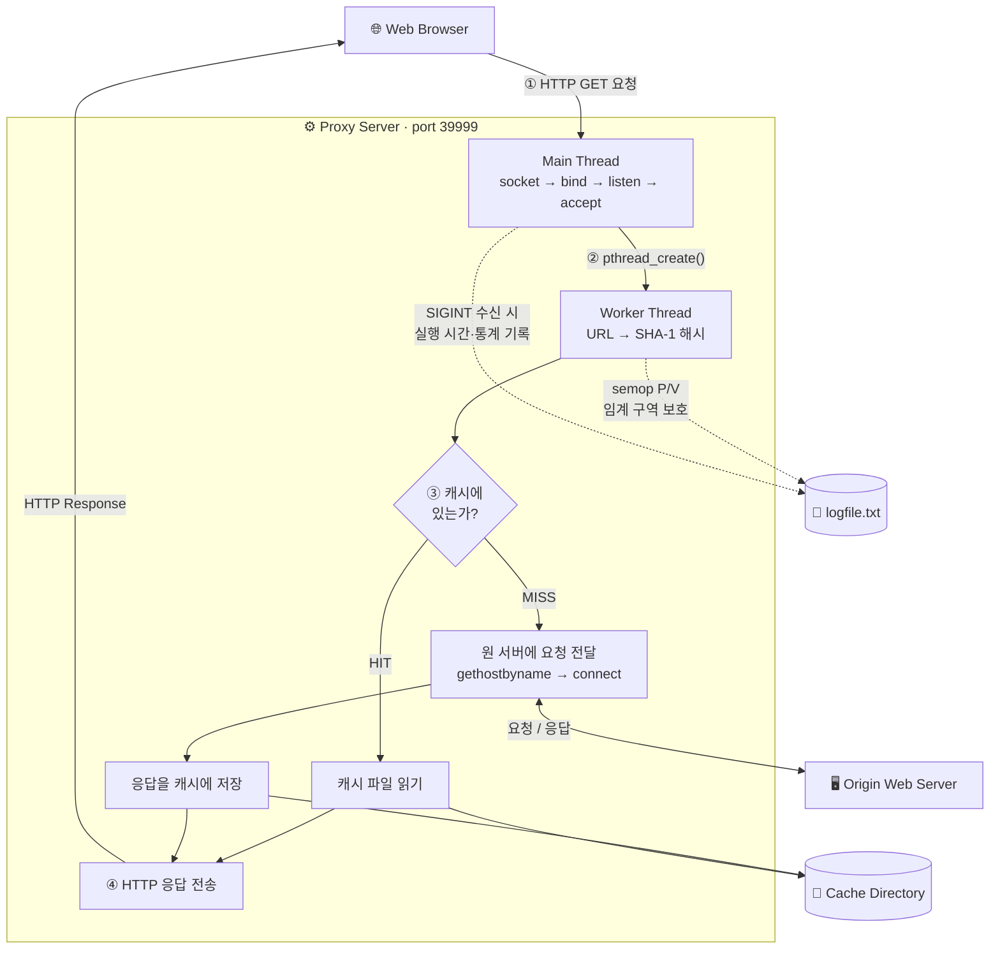

# ⚙️ System Programming

시스템프로그래밍 과목에서 진행한 과제를 모아둔 저장소입니다.  
Linux 기초 실습부터 시작해, **C로 구현한 Proxy Cache Server**를 9단계에 걸쳐 확장해 나갔습니다.

<br>

## 🗂️ Assignments

### 🐧 Basic

| 과제  | 내용                                         |                                                         바로가기                                                          |
| :---: | :------------------------------------------- | :-----------------------------------------------------------------------------------------------------------------------: |
| Basic | Ubuntu 설치, Linux 명령어 22개, vi, Makefile | [](./Basic_Linux-Commands-Makefile) |

### 📁 Phase 1 · 파일 시스템 & 프로세스

| 과제 | 내용                        |                                                           바로가기                                                           |
| :--: | :-------------------------- | :--------------------------------------------------------------------------------------------------------------------------: |
| 1-1  | SHA-1 기반 캐시 생성 (MISS) |     [](./Proxy1-1_SHA1-Cache-Miss)      |
| 1-2  | HIT/MISS 판별 & 로그 기록   | [](./Proxy1-2_Cache-Hit-Miss-Logging) |
| 1-3  | fork() 기반 멀티 프로세스   |  [](./Proxy1-3_Multi-Process-Fork)   |

### 🌐 Phase 2 · 네트워크 & 시그널

| 과제 | 내용                    |                                                       바로가기                                                        |
| :--: | :---------------------- | :-------------------------------------------------------------------------------------------------------------------: |
| 2-1  | TCP 소켓 Server–Client  | [](./Proxy2-1_Socket-Server-Client)  |
| 2-2  | HTTP 프록시 서버        | [](./Proxy2-2_HTTP-Proxy-Server) |
| 2-3  | 웹 서버 중계 & 타임아웃 | [](./Proxy2-3_Web-Relay-Timeout)  |
| 2-4  | SIGINT 처리 & 종료 통계 |    [](./Proxy2-4_SIGINT-Handling)    |

### 🔒 Phase 3 · 동기화 & 스레드

| 과제 | 내용                      |                                                      바로가기                                                      |
| :--: | :------------------------ | :----------------------------------------------------------------------------------------------------------------: |
| 3-1  | 세마포어 기반 로그 동기화 | [](./Proxy3-1_Semaphore-Sync)  |
| 3-2  | pthread 멀티스레드 서버   | [](./Proxy3-2_Multi-Thread) |

<br>

## 🔄 Proxy Server Architecture

프록시 서버의 동작 흐름입니다.



<br>

## 📝 Assignment Summary

### 🐧 Basic · Linux 기초

- **개발 환경 구축** : VMware Workstation에 Ubuntu 설치 후 커널 버전 확인
- **Linux 명령어 22개** : `ls`, `chmod`, `ln`, `ps`, `kill`, `grep`, `alias` 등 실습
- **핵심 개념** : 8진수 권한 모드, 하드 링크 vs 심볼릭 링크, `SIGTERM` vs `SIGKILL`
- **vi & Makefile** : vi 편집기 조작과 Makefile을 이용한 C 프로그램 빌드 자동화

### 📁 Phase 1 · 파일 시스템 & 프로세스

**1-1 · SHA-1 캐시 생성**

- 입력받은 URL을 **SHA-1**로 해시하고, 앞 3글자는 디렉터리 이름, 나머지는 파일 이름으로 사용해 캐시 구성
- `umask`와 `mkdir`로 권한을 지정해 캐시 디렉터리 및 파일 생성

**1-2 · HIT/MISS 판별 & 로깅**

- `opendir()`, `readdir()`로 캐시 디렉터리를 탐색해 **HIT/MISS** 판별
- `time()`, `localtime()`으로 요청 시각과 결과를 `logfile.txt`에 기록하고, 종료 시 실행 시간·HIT·MISS 통계 출력

**1-3 · 멀티 프로세스**

- `connect` 명령마다 **`fork()`로 자식 프로세스**를 생성해 URL 요청을 독립적으로 처리
- 메인 프로세스는 전체 실행 시간과 생성된 자식 프로세스 수를 추적

### 🌐 Phase 2 · 네트워크 & 시그널

**2-1 · Socket Server–Client**

- `socket` → `bind` → `listen` → `accept` 흐름의 **TCP 서버**와 클라이언트 구현
- 클라이언트마다 자식 프로세스를 생성해 처리하고, 서버 PID와 결과를 로그에 기록

**2-2 · HTTP Proxy Server**

- 웹 브라우저의 **HTTP 요청**을 직접 받아 URL을 파싱하고 HIT/MISS 결과를 HTML로 응답
- 요청별 자식 프로세스 처리, 클라이언트 IP 기록

**2-3 · Web Relay & Timeout**

- MISS 시 `gethostbyname()`으로 원 서버에 접속해 **요청을 중계**하고 응답을 캐시에 저장, HIT 시 캐시에서 바로 응답
- **`SIGALRM`** 으로 원 서버가 10초 내 응답하지 않으면 타임아웃 처리
- **`SIGCHLD`** 와 `waitpid()`로 종료된 자식 프로세스를 회수해 좀비 프로세스 방지

**2-4 · SIGINT Handling**

- **`SIGINT`**(Ctrl+C) 수신 시 서버 전체 실행 시간과 요청 통계를 로그에 기록하고 안전하게 종료

### 🔒 Phase 3 · 동기화 & 스레드

**3-1 · Semaphore 동기화**

- 여러 프로세스가 로그 파일에 동시에 접근할 때 생기는 **Race Condition** 문제 해결
- System V **세마포어**(`semget`, `semop`, `semctl`)로 임계 구역(Critical Section) 보호
- `sleep()`을 삽입해 대기·진입 과정을 실제로 관측하고 PID와 함께 출력

**3-2 · Multi-Thread Server**

- 요청 처리를 **POSIX 스레드**(`pthread_create`)로 전환해 프로세스보다 가벼운 병행 처리 구현
- 세마포어 동기화를 유지하고, 임계 구역 진입·이탈 시 **PID와 TID**를 함께 출력
- 프로세스와 스레드의 차이, 스레드 환경에서의 동기화 필요성 학습

<br>

## 🛠️ Tech Stack


<br>

## 🚀 How to Run

각 과제 폴더에서 아래 명령으로 빌드할 수 있습니다. (Ubuntu, OpenSSL 개발 라이브러리 필요)

```bash
sudo apt install libssl-dev   # 최초 1회
make
./proxy_cache
```

2-2 이후 과제는 브라우저의 프록시 설정을 `localhost:39999`로 지정한 뒤 웹 페이지에 접속하면 동작을 확인할 수 있습니다.

<br>

## 📁 Repository Structure

```
System-Programming/
├── Basic_Linux-Commands-Makefile/
├── Proxy1-1_SHA1-Cache-Miss/
├── Proxy1-2_Cache-Hit-Miss-Logging/
├── Proxy1-3_Multi-Process-Fork/
├── Proxy2-1_Socket-Server-Client/
├── Proxy2-2_HTTP-Proxy-Server/
├── Proxy2-3_Web-Relay-Timeout/
├── Proxy2-4_SIGINT-Handling/
├── Proxy3-1_Semaphore-Sync/
└── Proxy3-2_Multi-Thread/
```

<br>

## ©️ Copyright

Copyright © 2025 장서현. All rights reserved.

이 저장소의 코드와 보고서는 학습 및 포트폴리오 목적으로 공개합니다.  
**무단 복제 및 과제 제출 용도로의 사용을 금지합니다.**
